> 원래 [티스토리 블로그](https://randomhuman.tistory.com/6)에 쓴 글을 옮겨 왔습니다. 원문 카테고리: 공부/인공지능

**제목 : Multi-objective antibody design with constrained preference optimization**

ICLR 2025년도 제출한 논문, 아직 퍼블리싱 안됨(?)

[https://openreview.net/pdf?id=4ktJJBvvUd](https://openreview.net/pdf?id=4ktJJBvvUd)

기존에 있던
AbDPO([https://openreview.net/pdf?id=GN2GXjPyN8](https://openreview.net/pdf?id=GN2GXjPyN8)),
NCA(NIPS, 2024, [https://arxiv.org/abs/2402.05369](https://arxiv.org/abs/2402.05369)) 등등을 Key Paper로 잡고 논문을 작성한것으로 보임.

## 간단 요약

  항체를 생성하는 모델에 대하여 최적화를 하기 위한 강화학습류의 방법으로, 그냥 일반적인 강화학습은 생성 모델에 적용하기 까다롭고 항체 데이터의 경우 단백질 데이터보다 부족해서 쌩 강화학습 방법들이 안먹힘. 그래서 DPO 방식을 통해 생성 모델을 파인튜닝 시키는 방법임. 그런데 기존 DPO 방법은 선호 데이터 쌍이 필요하기 때문에 Rewrad 정의하는 방법으로 바꿔서 하는 NCA 방법으로 항체 생성 모델을 파인튜닝함

## 이해를 위한 배경 지식

- Antibody를 생성하는 Diffuison Model에 대한 기본 지식

- Antibody에 대한 기본적인 지식 (Antibody, Antigen, Epitope, CDRs, FC, Residue 이런 기본적인 생물 지식)

- Score-based 모델에 대한 배경지식 (SDE는 알면 좋음.)

- 강화학습에 대한 얕은 지식 (Policy, Reward만 알면 됨)

## 해당 리뷰를 읽고 얻을 수 있는 것

- 보편적인 Antibody를 Diffusion으로 생성하는 방법.

- DPO에 대한 얕은 이해

- NCA에 대한 이해

- Constrained Preferecne Optimizaition에 대한 이해 (귀찮아서 생략)

## AbNOVO의 기여

1. AbDPO의 다음과 같은 한계를 개선함

## 한계

 AbDPO의 방식 :  Directed Preference Optimization(DPO)라고 해서, A보다 B가 낫다라는 식으로 Preference를 모델이 학습하도록 하여, 데이터 생성하는 Policy를 선호하는 데이터 쪽으로 유도하여 데이터를 생성하는 방법

해당 방법은 Preference의 경우 A보다는 낫다 정도만 가능하지 수치형을 이용한 더욱 정교한 최적화가 불가능함.

또한 Pairwise에 대한 데이터가 필요함, A보다 B가 확실히 낫다라는 Labeling이 확실히 되어있어야 됨.

## 개선

NCA( NIPS, 2024, [https://arxiv.org/abs/2402.05369](https://arxiv.org/abs/2402.05369) )  방법을 채택하여 연속적인 수치값, 즉 Reward를 통해 Policy를 업데이트 할 수 있도록 Antibody 도메인에 접목함.

2. 제약항을 추가하여 데이터 생성을 최적화함

기존에 Antibody를 생성하는 논문들이 많았으나, 전부 Epitope에 대한 특이적인 결합력만을 최적화하는 데 중점을 두었음.

AbNovo는 특이적 결합력 이외에도 3가지 제약을 고려하여 최적화함

 1. non-specific binding ( Target 으로 하는 Antigen 외 에는 결합하면 안되니까. )

 2. self-association  ( 말그대로 단백질이 꼬여서 귀찮아지는 거 )

 3. stability ( 말그대로 안정성 )

이 3가지를 제약 조건으로 추가하고, 라그랑지안 승수법을 이용하여 dual term으로 만듦

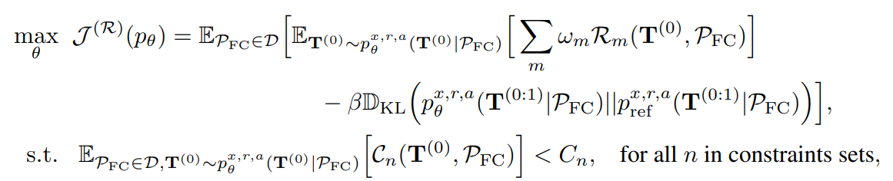

_제약이 있는 경우 Policy update Term_

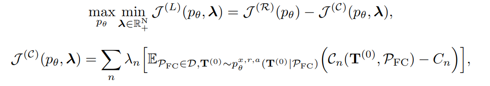

_라그랑지안 승수법을 통해 dual term으로 만든 결과_

이제 이렇게 만든 제약 Term을 NCA로 유도해내고, Antibody Diffusion에서 사용할 수 있도록 수학적으로 재정의하여 모델을 구축했다는 것 자체가 Contribution.

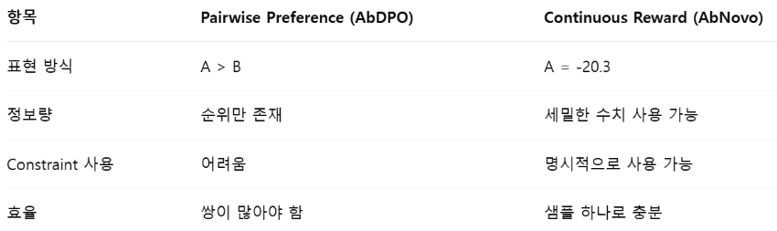

_단순히 AbDPO와 AbNOVO를 비교한 표(from GPT o3)_

개인적으로 대단하다고 생각이 듦, 수학적인 방법론을 내 도메인에 적용해서 수식을 유도해낼 수 있다는 거 자체가 나는 엄두를 못 내겠음 킼킼

자 이제 진짜 리뷰 들어감.

## AbNovo 구조

앞에 기여에서는  중요한 이야기를 다 빼먹고 설명해서 뭔소리냐라고 생각이 들었을 것임.

이제부터 설명을 시작하겠음.

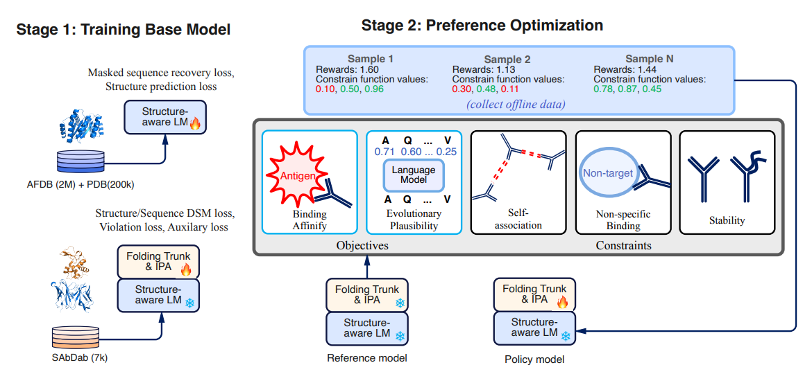

_AbNovo의 Framework_

AbNOVO의 경우 모델이 2단계로 나눠져 있음

**첫번째**는 Antibiody를 생성할 수 있는 Diffusion Model의 훈련, 이를 Base Model이라고 칭함.**두번째**는 Base Model을 Policy로 취급하여 Preference Optimization 방식의 강화학습을 통해 Fine-tuning을 하여 모델이 최적의 데이터만 뽑도록 최적화 시키는 것임.

차례대로 설명하겠음.

## Stage 1 : Training Base Model

SE(3) diffusion (ICML, 2023, [https://arxiv.org/abs/2302.02277)](https://arxiv.org/abs/2302.02277))
DFMs(ICML, 2024, [https://arxiv.org/abs/2402.04997)](https://arxiv.org/abs/2402.04997))
AbX(PMLR, 2024, [https://proceedings.mlr.press/v235/zhu24j.html)](https://proceedings.mlr.press/v235/zhu24j.html))

위 3가지 기존 연구들을 참고하여 다음과 같은 베이스 모델을 형성함.

기본적으로 해당 논문은 Antibody + Antigen Complex (항체-항원 복합체)를 다루는데,

특정 Antigen에 대한 결합력을 높이는 Antibody가 생성하는 게 목적인 경우가 대부분이라

해당 결합력을 높이는데 중요한 요인인 Antibody의 CDR 부분을 Design하는 게
대부분 Antibody 생성 모델들의 주요 목적임.

이때 당연히 Seqeucne 와 Structure를 동시에 설계하는 co-design을 다룸

## Notation

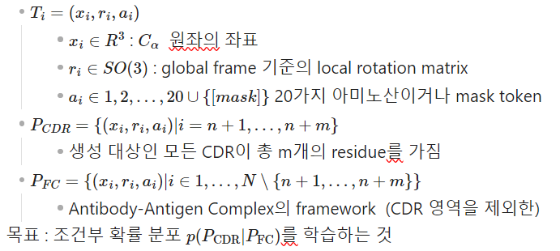

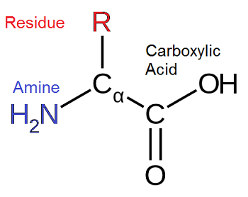

_옵시디언에 메모해놨던 내용 스샷 찍어 가져옴_

$x$의 경우 각 잔기(residue)를 이루는 $C_\alpha$(중심 탄소)의 3차원 좌표

$r$의 경우 각 잔기의 $SO(3)$ 회전 행렬

$a$의 경우 각 잔기의 서열을 discrete 하게 나타난 것.

$P_{CDR}$ 부분을 보면 n+1, n+m 부분이라고 적혀있는 부분이 이해가 안가시는 분을 위해 설명하자면,

{ 1, 2, 3, 4, 5, 6, 7, 8, 9, 10 } 이런 잔기가 있을 때 n = 3이고 m = 4라 했을 때 4, 5, 6, 7 부분이 단백질 서열의 CDR 부분 index라는 뜻임

$P_{FC}$ 부분은 단순히 CDR 부분을 제외한 모든 영역이라는 표시

$C_\alpha$ 좌표랑 잔기의 회전 행렬, 잔기 종류가 있으면 해당 잔기를 이루는 backbone의 좌표 계산이 가능한데,

보통 Dunbrack rotamer를 통해 잔기를 이루는 다른 원소들 좌표 계산이 가능함

*Dunbrack rotamer : Thomas Dunbrack 연구실이 PDB 구조 수십만개 분석해서 만든 백본-의존(회전 형태; rotamer) 라이브러리, 잔기 종류와 백본 각도를 주면 해당 조건에서 관측 확률이 높은 좌표값을 제공함

즉, 잔기를 이루는 모든 원자를 다룰 필요 없이 그냥 중심 탄소, 회전, 서열 정보만 있으면 알아서 예측이 된다는 것.

그러나.. 여러 논문들 봤을 때, 중심 탄소만 다루는 경우 복원했을 때 R 때문에 Crush가 나는 경우가 좀 흔한 현상이라고 함. **즉, 다른 원소는 괜찮더라도 R,  곁사슬의 경우에는 다룰 수만 있다면 모델의 정교함을 개선할 수 있을 거라 생각됨**

## 근데 어떻게 다룰건데..?

여튼 저렇게 주어진 T로 구성된 단백질 $P_{CDR}$ 과 $P_{FC}$를 통해 데이터를 생성한다고 보면됨.

여기서는 CDR를 생성하는 거니까 FC, 즉 Anbody-Antigen Complex 구조가 주어지면 그 구조에 해당하는 CDR를 생성한다고 보면된다.

## Forward Process

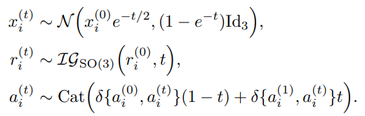

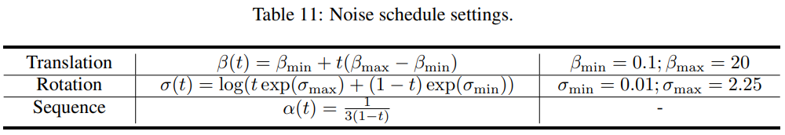

t는 U(0, 1) 균일분포에서 샘플링하였고, t에 대한 값은 Table 11에 있는 게 각 t임.

$\beta(t)$가 $x^{(t)}_i$에 사용되는 t라고 보면되고

  즉 $\beta(t) ∈ [0.1, 20]$ 로 선형적 증가

$\sigma(t)$가 $r^{(t)}_i$에 사용되는 t라고 보면되고

  즉 $\sigma(t) ∈ [0.01, 2.25]$ 로 log-linear 형태의 곡선 증가

$\alpha(T)$가 $a ^{(t)}_i$에 사용되는 t라고 보면 됨

  즉 $\alpha(t) ∈ [\frac{1}{3}, ∞)$   역수 형태로 발산

한다고 보면된다.

$x^{(t)}_i$ 는 Gaussian 분포에서 샘플링하여 노이즈로 만들었다는 것이고,

$r^{(t)}_i$ 은 Isotropic Gaussian 분포에서 샘플링하여 노이즈화 하였고,

$\alpha^{(t)}_i$ 는 Categorical 분포에서 샘플링하여 노이즈화 함.

카테고리 분포쪽 보면 $\delta$는 Kronecker delta 함수로 i = j 일때, 1이고 그 외에는 0이다.

여기서 1은 완전한 noise 'mask' , 0이면 원래 서열, 즉 1이면 더이상 noise step 진행 안한다는 거.

뭐 저기 분포에 들어있는 파라미터(평균 및 분산)은

각각 $q(x_t | x_0)$ 처럼  $x_0$에서 바로 noise인 $x_t$로 Forward 가능하게 설계해놓았을 것 같은데

앞에 있던 3개의 참고 논문에 나와있을 것 같다. 근데 굳이 찾아보진 않았다.

어련히 잘 해놨겠지 여기서 너무 힘빼지말자

뒤에도 충분히 복잡하다~

## Reverse Process

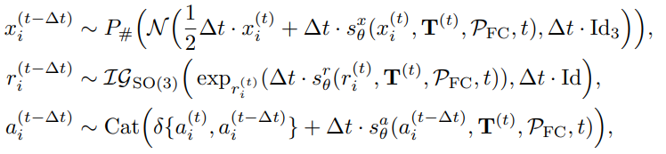

자 Reverse 연산이다. 빡세보이는건

Score-based Diffusion Model이라 그런다. SDE라는 개념을 알면 대충 이해는 갈 것이다.

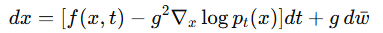

_보편적인 Reverse SDE 공식_

하나씩 살펴보자

**$x_i^{(t-\Delta t)} \sim \mathcal{P}^\#\!\Bigl(\mathcal{N}\!\Bigl(\tfrac12 \,\Delta t \, x_i^{(t)} + \Delta t \,s_\theta^{x}\!\bigl(x_i^{(t)},\mathbf{T}^{(t)},\mathcal{P}_{\mathrm{FC}},t\bigr),\,\Delta t \,\mathrm{Id}_3\Bigr)\Bigr),$**

우선 설명하기 앞서서 해당 SDE는 Variance Preserving SDE(VP SDE)인데, discrete time에 대한 VP SDE term이다.

평균 값의 경우는 drift term으로 $\frac{1}{2}\Delta t x_i^{(t)}$ 는 drift term이며, VP SDE에서 forward SDE가 표준정규분포에 수렴하게 만드는 term이다.

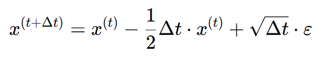

이게 VP SDE에 기본적인 SDE term이고

위와 완전히 똑같다. 이거는 그냥 따로 찾아보시길 바람. SDE 자체를 이해 못 하면 납득 못 하니까

$\Delta t \,s_\theta^{x}\!\bigl(x_i^{(t)},\mathbf{T}^{(t)},\mathcal{P}_{\mathrm{FC}},t\bigr)$의 경우에는  $s_\theta^{x}$ 부분이 이제 뉴럴네트워크가 학습하는 부분이라고 이해하면 된다.

결국에  요 부분은 SDE를 이해해야 납득할 수 있는 부분이기 때문에 기본적인 SDE를 공부해보고 다시보는걸 추천한다.

$P_\#$은 projection matrix라고 하는데 구조를 translation 해도, 모델이 영향을 받지 않게 만들기 위해 구조의 중심(center of mass)을 원점으로 정규화하는 연산이다. translation-invariant 모델링을 위한것인데..

쉽게 설명하면, 절대 좌표를 무시하고 $x_i - x_j$ 같은 원소간의 상대적인 좌표 차이만을 이해할 수 있게 만든다는 것이다. 어떤 좌표에 있던 똑같은 단백질에 대해서 똑같은 결과가 나오도록 보장할 수 있도록 한다고 보면된다.

**$r_i^{(t-\Delta t)} \sim \mathcal{IG}_{\mathrm{SO(3)}}\!\Bigl(\exp_{r_i^{(t)}}\!\bigl(\,\Delta t \, s_\theta^{r}\!\bigl(r_i^{(t)},\mathbf{T}^{(t)},\mathcal{P}_{\mathrm{FC}},t\bigr)\bigr),\,\Delta t \,\mathrm{Id}\Bigr)$**

$dr_t = -s_\theta(r_t,t)dt +d\bar{w}_t$

이거 같은 경우에는 기본적으로 dritft term이 없는 순수 확산 과정을 하기 때문에 앞서 봤던 $\frac{1}{2}\Delta t $ 같은 게 없다. 대신에 막 $\exp$ 같은 게 있는데 이거는 SO(3) 공간에서는 더하거나 뺀다는 개념을 하지 못 함,
그래서 SO(3)를  Lie lgebra so(3) 벡터 공간으로 변환해서 더하거나 빼는 개념을 적용해야함.

$s_\theta^{r}\!\bigl(r_i^{(t)},\mathbf{T}^{(t)},\mathcal{P}_{\mathrm{FC}},t\bigr)$

사실상 해당 네트워크 같은 경우 so(3) 공간에서 디퓨전하는 네트워크가 후처리 해서 SO(3)로 만든다는 느낌이라고 보면됨. 근데 이제 so(3) -> SO(3)로 만드는 연산 과정에 $\exp$가 쓰여서 $\exp$로 묶여있는 것이라 이해하면됨.

**$a_i^{(t-\Delta t)} \sim \mathrm{Cat}\!\Bigl(\delta\!\bigl\{\,a_i^{(t)},\,a_i^{(t-\Delta t)}\,\bigr\}\Delta t  + s_\theta^{a}\!\bigl(a_i^{(t-\Delta t)},\mathbf{T}^{(t)},\mathcal{P}_{\mathrm{FC}},t\bigr)\Bigr).$**

서열 a에 대한 Categorical 분포에 대한 Denoising 과정인데

$\delta \{a_t, a_{t-\Delta t} \}\;\Delta t$에서 보면

$\delta \{a_t, a_{t-\Delta t} \}$ 부분은 denoise한 step이 현재 스탭과 비교했을 때 과도한 변화를 방지하기 위한 term이고 $\Delta t$가 0으로 수렴하면 결국 영향력이 0이 되버려서 denoise하는 끝단에서는 결국 제약이 없어지고

아래 Term에 의존하게 됨.

$s_\theta^{a}\!\bigl(a_i^{(t-\Delta t)},\mathbf{T}^{(t)},\mathcal{P}_{\mathrm{FC}},t\bigr)$

이거는 이제 어떤 카테고리가 더 확률이 높냐에 대한 학습하는 term임.

이렇게 또 설명하고 보니 이해가 쉽죠?

그래서 Diffusion은 위 3가지를 한다고 보면됨.

그러면 이제 Base Model이 어떻게 구성되어있는지 확인해보자.

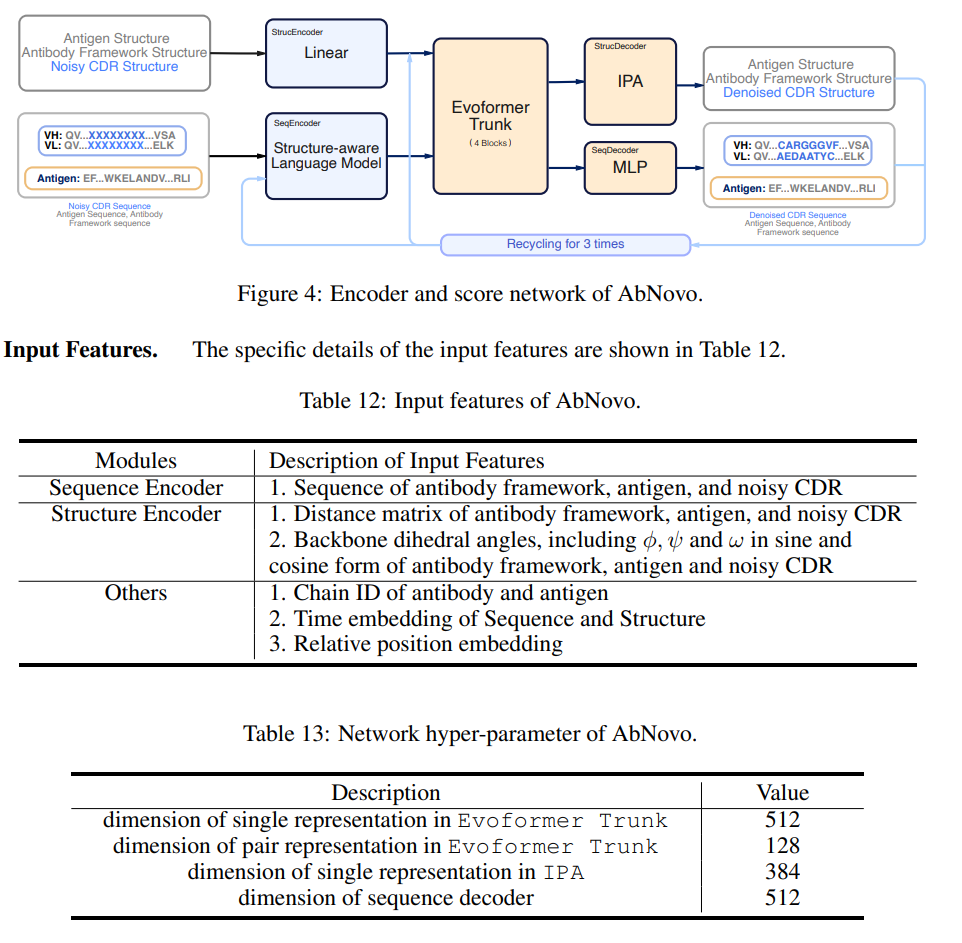

_AbNovo Base Model Framework_

일단 Diffuision Model은 Reverse Process만 학습하는 모델이기 때문에.  Input은 전부 Noise화된 게 들어감.

근데 이제 들어가기 전에 각각 표현력 상승을 위해 Linear 및 Structure-aware Language Model를 쓴걸 확인 가능함.

Seqeucne의 경우 구조 정보가 없기 때문에 사전 학습된 좋은 모델을 한번 더 파인튜닝해서 써서 표현력을 높였다고 함.

이거는 뭐 궁금하면 직접 논문 찾아보시길, 저는 방법론에 대한걸 집중적으로 볼 거라서 ㅎ

여튼 그렇게 얻은 표현을 AlphaFold2에서 쓰는 걸 그대로 가져다 써서 Evoformer Trunk를 통해 Denoising 하고 IPA나 MLP 같은 Decoder로 복원, 그리고 그걸 3번 정도 더 해서 정제함.

Base Model 끝

## Stage 2 : Preference Optimization

자 이제 지옥 시작인데.

머리가 나빠서 이거 이해하는 데 좀 오래걸림 .

우선 Base Model을 학습을 다 시켰다는 전제를 깔아둔다.

## 최종목표 : Base Model을 일종의 강화학습을 사용해서 원하는 데이터만 뽑도록 업데이트 하는 게 목표

우선 **강화학습**에 대한**기본**부터 천천히 설명하겠음..**기본적인 강화학습 방식**

$\nabla_{\theta} \, \mathbb{E}_{x \sim p_{\theta}} [R(x)]$

$p_\theta$가 이제 Base Model(이하 Policy라고 부름)이 생성한 x를

$R(.)$이라는  Reward Function을 통해 측정했을 때, 그 Reward에 대한 기댓값이 높은 policy $\theta$를 얻는 것이 강화학습에 목표임.

그런데 여기서 문제는 x가 샘플링(생성)되고, 이제 이 샘플링된 x를 $R(.)$함수를 통해서 측정하는데, 이 과정에서 $\theta$에 대한 gradient가 끊킴.. 즉 기댓값을 얻어도 policy를 개선시키지 못 함.

그래서 보통 로그 미분 트릭을 사용해서

$\nabla_{\theta} \, \mathbb{E}_{x \sim p_{\theta}} [R(x)] = \mathbb{E}_{x \sim p_{\theta}} \left[ R(x) \nabla_{\theta} \log p_{\theta}(x) \right]$  이렇게 Gradient가 전달될 수 있도록 Reward를 그냥 gradient에 가중시키는 방식으로 Policy를 업데이트 시킴.

이게 이제 미분 불가능한 Reward를 이용해서 강화학습이 돌아가는 기본적인 원리임.

## AbNOVO 강화학습 방식

이제 AbNovo의 목표는

$\max_{p(x)} \, \mathbb{E}_{x \sim p(x)}[\hat{R}(x)] - \beta \, D_{\text{KL}}(p(x) \| p_{\text{ref}}(x))$

여기서 $\hat{R}$은 사용자가 정의한 Reward Function임.

$\beta$의 경우 그냥 하이퍼파라미터이고,

$p_{ref}$의 경우 BASE Model임.

좌항의 경우 기본적인 강화학습의 목표이고, 오른쪽 KLD term은 업데이트 할 때, BASE Model의 분포를 너무 벗어나 모델이 붕괴되는 것을 막기 위한 일종의 제약 term이다.

여기까지는 아직 쉽죠?

그러면 이제 $p_\theta$ (policy)를 업데이트 하는게 목적이니까  $p(x)$ 자리에 $p_\theta(x)$를 넣어서 전개해보자.

$\max_{p(x)} \, \mathbb{E}_{x \sim p(x)}[\hat{R}(x)] - \beta \, D_{\text{KL}}(p_\theta(x) \| p_{\text{ref}}(x))$

이거를 max 문제에서 min 문제로 바꾸고 $\beta$를 전부 나눠준다.

$\min_{\theta} \left\{ -\frac{\mathbb{E}_{p_{\theta}}[R]}{\beta} + D_{\text{KL}}(p_{\theta} \| p_{\text{ref}}) \right\}$

이제 Expectation을 풀고, KLD 항도 log 형태로 다시 푼다.

$min_\theta\left\{-\frac{1}{\beta} \sum_{i} p_{\theta}(T_i) R_i + \sum_{i} p_{\theta}(T_i) \log \frac{p_{\theta}(T_i)}{p_{\text{ref}}(T_i)}\right\}$

여기 보면 사실상 $p_\theta$가 같은 Expectation으로 묶이니까 합칠 수 있다.

합치는 과정에서 $\exp$도 감싸면 아래와 같이 된다.

$min_\theta\left\{\sum_{i} p_{\theta}(T_i) \log \frac{p_{\theta}(T_i)}{p_{\text{ref}}(T_i) \exp(R_i / \beta)}\right\}$

오 뭔가 형태가 보이는가?  $\exp$ 로 감싸면 볼츠만 분포로 나타낼 수 있는 가능성이 생긴다.

$P(x) = \frac{1}{Z} \exp\left(-\frac{E(x)}{k_B T}\right)$ 볼츠만 분포의 경우 이렇게 생겼는데

위에서 분모 분자에 볼츠만 정규화 상수 Z를 도입하면

$min_\theta\left\{\sum_{i} p_{\theta}(T_i) \log \frac{p_{\theta}(T_i)}{\frac{p_{\text{ref}}(T_i) \exp(R_i / \beta)}{Z}} - \log Z\right\}, \quad Z = \sum_{j} p_{\text{ref}}(T_j) \exp(R_j / \beta)$

이렇게 볼츠만 상수를 분모 분자에다 각각 곱해주고 분모에 있는 Z는 $\log$니까 밖으로 빼면 $-\log{Z}$로 나타내고 이제 볼츠만 분포 형태가 도입된 형태로 변하게 된다..

이때의 볼츠만 정규화 상수는

$Z = \sum_{j} p_{\text{ref}}(T_j) \exp(R_j / \beta)$  이다.

$q(T_i) = \frac{p_{\text{ref}}(T_i) \exp(R_i / \beta)}{Z}$ 볼츠만 분포를 $q(T_i)$로 치환해서 다시 쓰면

최종적으로 (최종 아님)

**$min_\theta\left\{D_{KL}(p_\theta(T_i) || q(T_i) ) - \log{Z}\right\}$**

이렇게 나타낼 수 있다.

근데 그냥 저렇게 접근해버리면 Z값이 Intractable 하기 때문에 그대로는 못 쓰고.. 다른 측면에서 접근해야한다.

(물론 위에 term을 활용한 강화학습 방법 논문도 있긴 하다 그냥 근사하는 느낌으로 하지만 우리는 DPO가 목적이기 때문에 그건 찾아보지 않겠다.)

여기부터 진짜 어려워서 나도 제대로 이해했는지 모르겠지만, 일단 설명해보겠다.

자 다시 위에 term을 가져와보자.

$min_\theta\left\{D_{KL}(p_\theta(T_i) || q(T_i) ) - \log{Z}\right\}$

해당 term에서 사실상 모델이 근사하려는 closed-form의 최적해인 경우를 보면

$p_\theta$ 와 $q$ 분포가 같은 분포여서 KLD = 0으로 수렴하는 꼴일 것이다.

즉 다시 나타내면

$p^*(T_i) =  p_{\text{ref}}(T_i) \frac{\exp(R_i / \beta)}{Z}$ 이다.

이를 해석 해보면

$\underbrace{p_{\text{ref}}(T)}_{\text{Base Model}} \times \underbrace{\frac{\exp(R(T)/\beta)}{Z}}_{\text{보상 항}}$

여기 보면 그냥 기본 Base Model에 어떠한 보상 가중치가 곱해진 항으로 볼 수 있다.

우리의 목표는 보상을 높게 주는 최적의 Policy를 찾는 것이었다.

$p^*(T_i) =  p_{\text{ref}}(T_i) \frac{\exp(R_i / \beta)}{Z}$

이거를 $\log$ 씌우고 다시 재정리하면

$\log{\frac{p^*(T)}{p_{ref}(T)}} = \frac{R(T)}{\beta}-\log{Z}$ 이렇게 logit 형태로 나타낼 수 있다.

이거를 $g(T)$라고 두면

$g(T)=\log{\frac{p^*(T)}{p_{ref}(T)}} = \frac{R(T)}{\beta}-\log{Z}$

형태로 나타낼 수 있는데. 이를 Teacher logit 이라고 한다.

이를 해석해보자.

- policy가 $p^*$ 분포에서 나왔다면 분자가 더 크니까 $g(T)$는 높을 것이다.

- policy가 $p_{ref}$ 분포에서 나왔다면 분모가 더 크니까 $g(T)$는 낮은 값이 나올 것이다.

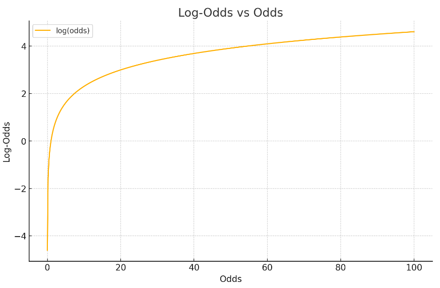

(x축이 $ \frac{p^*(T)}{p_{ref}(T)}$ 이고, y축이 x축에 log를 씌운 갚이다. 이를 그래프로 나타낸 것 )

그러니까, policy가 어디서 나왔는지 판단할 수 있는 분류 모델로 볼 수 있다는 것이다.

이 Teacher Logit을 수학적으로 얻었으니 $p_\theta$ (policy)가 근사할 수 있도록 student logit을 만들어야 된다.

$f_\theta(T) = \log{\frac{p_\theta(T)}{p_{ref}(T)}}$ 간단하게 이렇게 나타낼 수 있다.

결국에는 강화학습을

$f_\theta(T) ≒ \log{\frac{p^*(T)}{p_{ref}(T)}} = \frac{R(T)}{\beta}-\log{Z}$

Teacher Logit을 근사시키는 분류 문제로 바꾼 것이다.

이 Student logit이 만약 Teacher Logit을 잘 근사했다면 $p_\theta$의 확률이 높은거만 뽑으면 최적 데이터를 얻는 것이다..

그럼 이 Teacher Logit과 Student Logit을 수학적으로 설정해놨으니,

이제 Loss만 설계하면 끝이 난다.

조금만 힘내자.

## NCA Loss

우리가 앞서 Teacher Logit을 설계했다.

$\log{\frac{p^*(T)}{p_{ref}(T)}} = \frac{R(T)}{\beta}-\log{Z}$

두 가지 문제가 있는데.

1. 어떻게 Teacher Logit에서 샘플을 뽑을 수 있는가?

2. 정규화 상수 Z를 어떻게 할것인가?

순서대로 보자.

## Teacher Logit에서 어떻게 샘플을 뽑는가?

$\log{\frac{p^*(T)}{p_{ref}(T)}} = \frac{R(T)}{\beta}-\log{Z}$

여기서 사실상 $p^*(T)$가 문제인건데 사실 우린 이미 전개하면서 얻어놨다.

$p^*(T_i) =  p_{\text{ref}}(T_i)\frac{\exp(R_i / \beta)}{Z}$

즉, BASE Model인 $p_{ref}$에서 뽑은 샘플에서

$\frac{\exp(R_i / \beta)}{Z}$라는 보상 가중치를 곱하면 된다!!!!

참 쉽죠?

## 정규화 상수 Z를 어떻게 할것인가?

정규화상수는 In-batch sfotmax 또는 Approximate softmax over mini-batch 방법..

쉽게말해 Batch 단위로 Loss를 계산하면 정규화 상수 Z를 없앨 수 있음.

$\frac{\frac{\exp(R_i / \beta)}{Z}}{\sum^K_{j=1}{\frac{\exp(R_j/ \beta)}{Z}}}$

이런 형태로 가중치가 형성 되면서 분자와 분모에 있는 똑같은 Z를 없애버리는 것..

전체적인 Loss를 보면 딱 직관적으로 이해가 되는데

$\mathcal{L}_{\mathrm{NCA}}^{\mathrm{diff}}(\theta) = - \sum_{i=1}^{K} \left[ \frac{\exp\left( \hat{\mathcal{R}}_i / \beta \right)}{\sum_{j=1}^{K} \exp\left(\hat{\mathcal{R}}_j/\beta\right)}\log \sigma\left( f_\theta\left( \mathbf{T}_i^{(0)}, \mathcal{P}_{\mathrm{FC}} \right) \right)+\frac{1}{K} \log \sigma\left( -f_\theta\left( \mathbf{T}_i^{(0)}, \mathcal{P}_{\mathrm{FC}} \right)\right)\right]$

여기서 log-sigmoid 하는 이유는 log-likelihood 형태로 만들어서 분류 관점에서 그냥 log-likelihood를 높이는 방법으로 다시 바꾸는 것.

결국 식에서도 보일텐데, 가중치를 곱한 부분이 $p^*$인거고, $\frac{1}{K}$ 이 부분이 $p_{ref}$에서 온 부분임. 즉 어느 분포에서 왔느냐를 Constrative Loss로 나타낸 게 위에 Loss이다.

이걸 이해했다면 정말 다 왔다.

위에 Loss를

$f_\theta(T) = \log{\frac{p_\theta(T)}{p_{ref}(T)}}$에 넣어줘서 다시 정리한다.

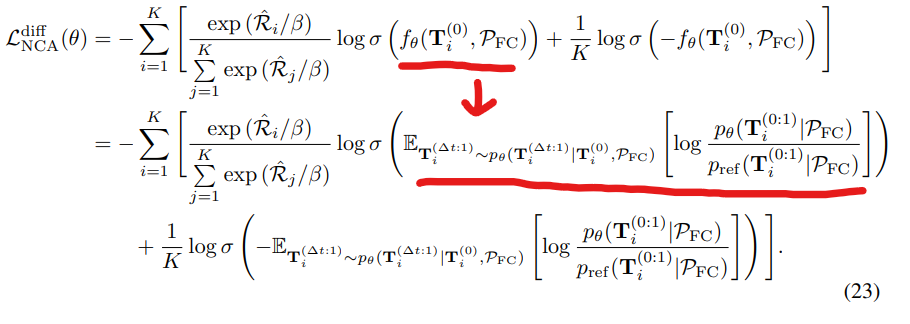

정리 해놨더니 문제가 있는데,

 $p_\theta(T^{(\Delta t:1)}_i | T^{(0)}_i, P_{FC})$에서 샘플링하는건 불가능함.

왜냐하면 $p_\theta$는 Reverse Process 밖에 학습하지 않았으니까.

근데 뭐 사실상 우리 Forward Process는 수식적으로 정의했으니까 걍 그걸로 대체해도 가능하다고 함.

(Wallace et al. 2024, CVPR 2023, [https://arxiv.org/abs/2311.12908](https://arxiv.org/abs/2311.12908))

$q(T^{(\Delta t:1)}_i | T^{(0)}_i, P_{FC})$로 대체해서 다시 정리

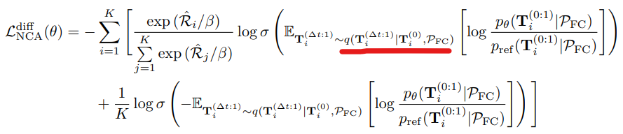

여기서 이제 시계열 데이터 (0:1)를 기댓값으로 풀어서 표현하면 아래와 같음

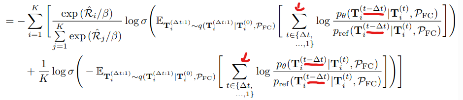

각 time step에서 time step으로 넘어갈 때 얻어진 logit에 대한 평균으로 표현한 후 앞으로 빼버리면 아래와 같음.

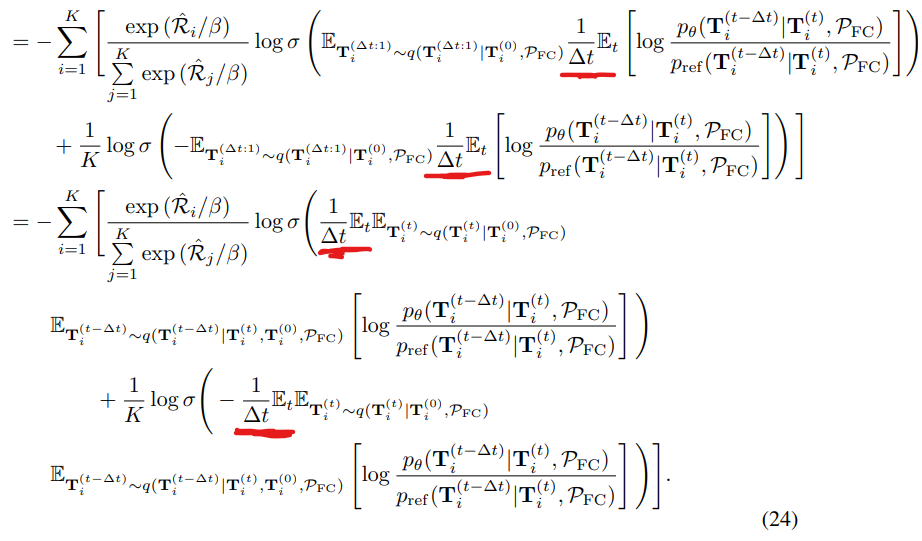

이렇게 기대값이랑 $\log$가 같이 있는 경우 Jensen 부등식을 사용해 기댓값을 $\log$ 밖으로 뺄 수 있다.

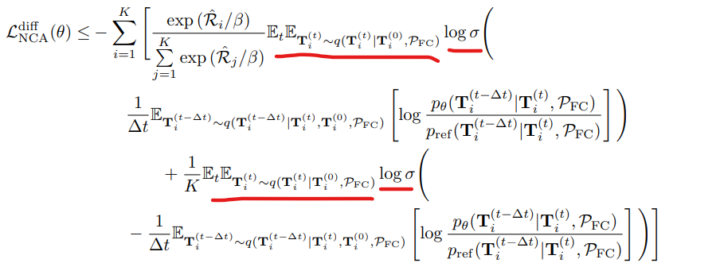

마지막으로 좌항 우항에 있는 공통된 기댓값을 아예 밖으로 빼버린다.

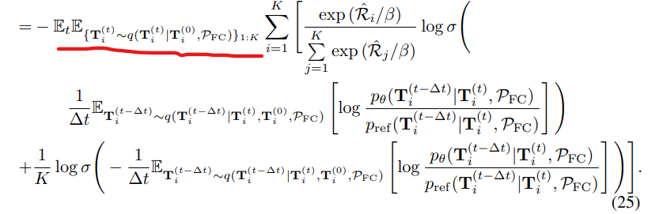

위 형태는 KLD term으로 변환하면 아래와 같이 간단하게 나타낼 수 있게 된다.

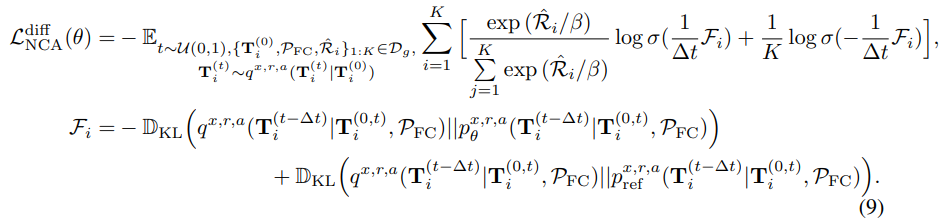

이렇게 정리하고 나면 사실상 Denoised Score Matching 손실값 이용해서 Constrastive Loss 하는 형태가 되는데

이를 최적화 시켜서 Loss를 수렴시키면.

$p_\theta = p^*$이 되어 뭘 뽑든 보상이 높은 데이터를 생성하게 되는 것이다!!!!!!

## 자 이게 바로 DPO를 개선한 NCA Loss 유도이다.

이제 남은 문제는

$\hat{R}$이 어떻게 되어있는가를 확인하는 것이다.

AbNovo에서는 비특이성, 자기응집, 안정성 이 3가지를 제약으로 준다고 했지 않는가?

여기 $\hat{R}$ 함수에 제약을 라그랑지안 승수법을 통해 추가함으로써 라그랑지안 승수 $\lambda$와 Policy를 순서대로 최적화 하여 제약을 완수한다.

근데 라그랑지안 승수로 제약 Term 추가해서 Strong Duality 입증한다고 하는데,

이 부분은 사실 제약조건을 추가한 Loss 구성할 때 많이 하는 방법이니까

설명은 생략하겠다.

알아보고 싶다면 "라그랑지안 승수법, 제약 조건" 이런 키워드로 검색하거나

GPT한테 물어보길 바란다. 나보다 잘 설명했을 것 같다.
