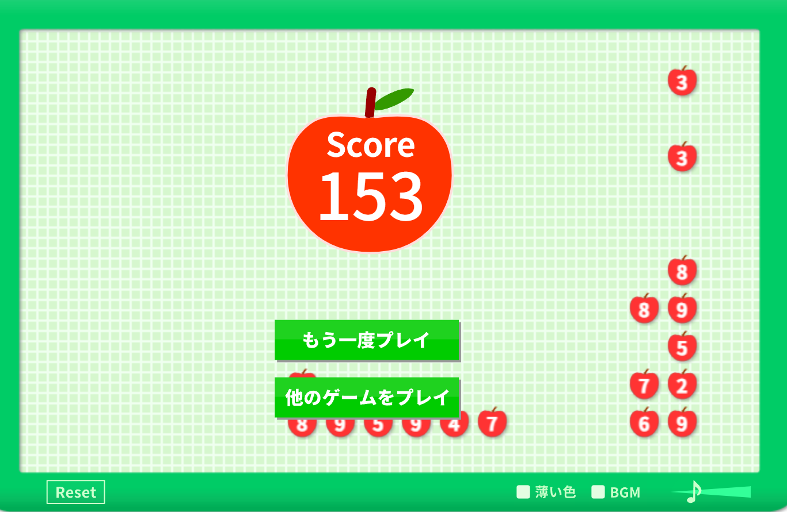
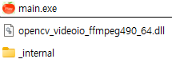
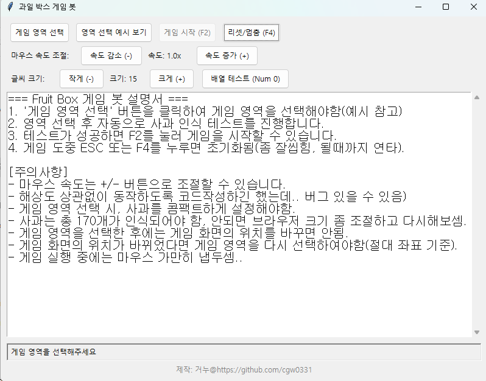
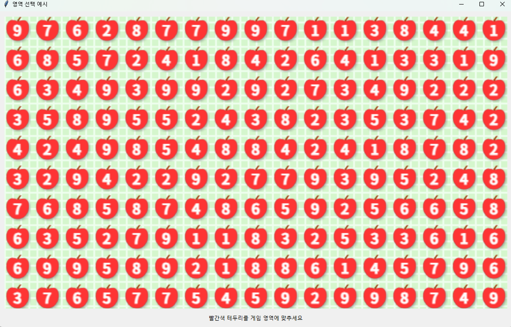
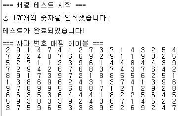
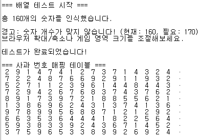

> 원래 [티스토리 블로그](https://randomhuman.tistory.com/7)에 쓴 글을 옮겨 왔습니다. 원문 카테고리: 게임, #매크로

_사과 게임 매크로_

요즘 유명한 사과 게임,

4년 전에도 열심히 했었는데 최근 다시 떠서 다시 열심히 하고 있다 ㅋㅋ

그러다 매크로를 만들어 보고 싶어서 만들기로 했다.

알고리즘은 이미 널리 퍼져있어서,

알고리즘을 기반으로 아무데서나 다운받아서 쓸 수 있도록 파이썬으로 프로그램을 만들었다.

아래에서 받아서 실행하면 된다. 파일이 커서 분할 압축했으니 네 개를 모두 같은 폴더에 받고 `.zip`을 풀면 된다.

- [사과 게임 매크로.zip](https://blog.kakaocdn.net/dn/cR5Psa/dJMcaiookqK/2slwKGy7gmKGkkGu3ZDlz0/%EC%82%AC%EA%B3%BC%20%EA%B2%8C%EC%9E%84%20%EB%A7%A4%ED%81%AC%EB%A1%9C.zip?attach=1&knm=tfile.zip) — 17.12MB

- [사과 게임 매크로.z01](https://blog.kakaocdn.net/dn/bogVGP/dJMcad1D6GP/p7yLcaszBzBvQTXDKn9ik0/%EC%82%AC%EA%B3%BC%20%EA%B2%8C%EC%9E%84%20%EB%A7%A4%ED%81%AC%EB%A1%9C.z01?attach=1&knm=tfile.z01) — 19.53MB

- [사과 게임 매크로.z02](https://blog.kakaocdn.net/dn/mGBZj/dJMcad1D6Gt/sOn5R2DIp9cfkM5dYx40eK/%EC%82%AC%EA%B3%BC%20%EA%B2%8C%EC%9E%84%20%EB%A7%A4%ED%81%AC%EB%A1%9C.z02?attach=1&knm=tfile.z02) — 19.53MB

- [사과 게임 매크로.z03](https://blog.kakaocdn.net/dn/NLp23/dJMcachpUip/8ivoqq4TeGUNQP9BoJAJb0/%EC%82%AC%EA%B3%BC%20%EA%B2%8C%EC%9E%84%20%EB%A7%A4%ED%81%AC%EB%A1%9C.z03?attach=1&knm=tfile.z03) — 19.53MB

아래는 사과 게임 링크 (사과 박스 게임 바로가기다 [ctrl + 클릭] 으로 새창으로 열면된다.)

[https://www.gamesaien.com/game/fruit_box_a/](https://www.gamesaien.com/game/fruit_box_a/)

_폴더 안에 main.exe 실행하면 됨._

## 사용법

사실 설명란은 귀찮아서 오타도 있다. 그냥 버튼 보고 직관적으로 사용하면 된다.

그래도 설명은 해보겠다.

우선 프로그램을 열어서 게임 영역 선택을 누룬다.

1. **게임 영역 선택** 하면 사과 박스 게임 영역 감싸면 됨.

_영역 선택시 딱 맞게 해야 miss 안남_

영역을 감싸면 이제 그 좌표를 기준으로 마우스를 움직인다.

영역을 그림처럼 딱 맞게 설정해야 배열을 잘 인식하낟.

2. **배열 테스트 (Numpad 0)** 하면 170개 사과가 다 보여야함.

_정상적인 배열 VS 잘못된 배열_

배열 테스트를 해보고, 해당 좌표가 인식이 잘되는지 판단해야 한다.

왼쪽 같이 170개가 인식이 되어야하는데, 이러면 바로 시작을 누루면 된다.

그러나 오른쪽 같이 170개가 아니라, 160개만 보이면 이미지 인식을 제대로 못 한 것이다.
사과 게임을 [Ctrl + 마우스 휠] 로 를 확대하거나 해서 영역 설정 다시 하고 배열 테스트를 해보자.

배열 테스트 했을 때 170개가 잘 인식되어야 잘 작동한다.

3. **게임 시작 (F2)** 누루고 계산 기다리기

시작하면, 7초 정도 소요되며, 알고리즘을 계산한다.

이때 예상 점수 뜨니까 마음에 안들면 ESC로 마우스 멈춘다음에, 리셋하고 다시하면 된다.

리셋이라 쓰긴했는데, 설정한 영역은 계속 남아있으니, 그냥 다시 F2를 누루면 된다.

반복해서 170 나올때까지 도전해보자

프로그램에 사용된 계산 알고리즘은 아래 깃허브에서 다운받았다.

사실 강화학습 방법으로 해보고 싶었는데,

강화학습으로 만들었던거는 50점~70점도 안나와서 그냥 알고리즘 다운받아서 했다.

또한 이미지 인식을, ResNet같은 이미지 인식 딥러닝 모델을 활용해보고 싶었는데,

그냥 사전학습된거를 쓰려니까 이상했다.

잘 인식시키려면, 사과게임 숫자를 이미지로 따서 데이터셋 구축해서

파인튜닝을 해야되는데, 데이터셋 구축이 귀찮아서 안했다.

또 숫자 형태가 다양한 게 아니라 고정되어있어서 그냥 OpenCV로 처리하니까 더 인식이 잘되었다.

알고리즘 원작자 깃헙

[https://github.com/kevinychen/fruit-box-bot](https://github.com/kevinychen/fruit-box-bot)

제 깃허브는 [github.com/cgw0331](https://github.com/cgw0331) 입니다.

깃허브에 코드를 올려놓긴 했는데,

정리를 안해서 더티하니까 그냥 프로그램만 다운받아 사용하길 권장한다.
